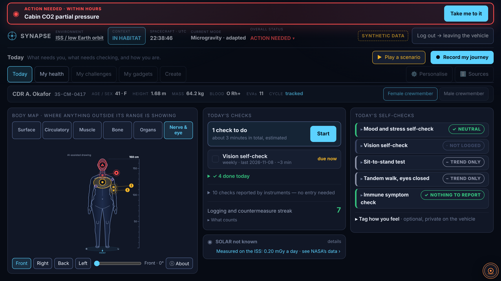
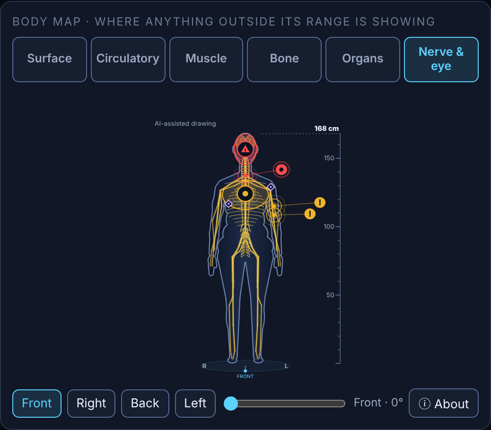
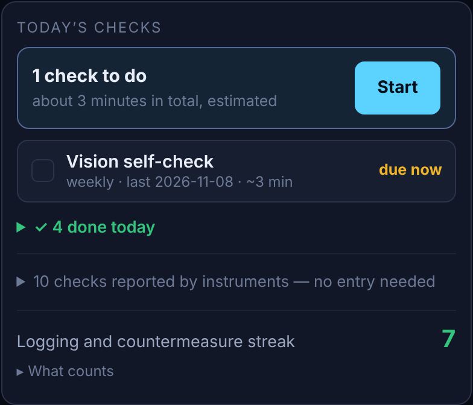

# SYNAPSE

**A health-monitoring prototype that lets an astronaut with no medical training read their own health, understand what needs attention and know what to do next, when help from Earth is hours or days away.**

**Demo prototype: [👉 Click here](https://synapsetechnologies.us/)** (the same build is also at [habbine.github.io/synapse](https://habbine.github.io/synapse/))

**Presentation (PPT): [👉 Click here](https://synapsetechnologies.us/docs/Synapse_Space_Systems.pdf)** (7 pages) · [download the PDF](https://github.com/habbine/synapse/raw/main/docs/Synapse_Space_Systems.pdf)

> [!WARNING]
> Research prototype: not a NASA product and not endorsed by NASA. It is not a medical device and makes no diagnosis. All crew data is synthetic. See [Limits of this prototype](#limits-of-this-prototype).



**Team 3S (Synapse Space Systems):** Habbine Estelle KIM and Ishan SINHA. "3S (Synapse Space Systems)" is our hackathon team name, not a company. We take part in a personal capacity.

## About the team

- **Ishan SINHA** is a maritime engineer.
- **Habbine Estelle KIM** is an attorney-at-law registered with the Paris and New York bars.

Our motto: *Think outside the box, but inside the criteria.*

## About the challenge

> Long-duration missions expose astronauts to space radiation, isolation and confinement, altered gravity, and a hostile closed environment, which can bring immune changes, bone loss, cardiovascular events, and behavioral health problems. On long missions, astronauts carry much of the responsibility for spotting these changes in themselves. Your challenge is to build a health monitoring software that gathers health indicators and enables astronauts to evaluate and act on the status of their health.

Challenge statement, NASA Space Apps Challenge 2026: "Create Health Monitoring Software for Astronauts on Space Missions". See the [2026 challenges page](https://www.spaceappschallenge.org/2026/challenges/).

## The problem we address

Long-duration missions carry many risk factors for human health and performance, and the astronaut is often the first, and for long stretches the only, person able to notice a change.

- **Purpose:** help astronauts monitor their health and take timely, health-related action.
- **Object:** navigating and making health monitoring easier.
- **Scope of impact:** cognitive, physical, psychological and behavioural health.
- **Conditions:** long mission duration; microgravity, radiation and extravehicular activity (EVA); limited space, resources and materials; and a communication delay with Earth that grows with distance, so help cannot always be immediate.

## Our solution in six functions

| Function | What SYNAPSE does today |
|---|---|
| Evaluation and restriction | Takes the mission context (environment, who is aboard, what is installed) and only judges what applies. A habitat air or radiation module is not installed on an Earth deployment. |
| Continuous monitoring | Daily and weekly checks with a countdown, instrument feeds where a device is connected, and hand-entered results marked as such. |
| Risk identification | Each reading is judged against three frames: the crew member's own pre-flight baseline, their rolling norm in the current context, and a published standard. Urgency is graded and shown by word and shape as well as colour. |
| Assistance and support | Every alert names what to do next, including when the instrument is at fault. EVO speaks alerts, reminders and check points. |
| Report and data analytics | Trends for every tracked indicator, next to real ISS radiation and CO2 measurements. The record can be downloaded as JSON for the crew member, a flight surgeon or a researcher. |
| Learning and guidance | Instrument guides, a plain-language explanation of where each limit comes from, and a pre-launch session to set language, reading level and personal baselines. |

## What it does

Far from Earth, a crew cannot call a doctor and wait for an answer. The interface is interactive: it turns health data into visuals a non-specialist can read, and it teaches as it goes.

- **Today**: one screen showing what needs action now, what is due, and a turnable body map marking any system outside its expected range.
- **Alerts with a next step**: each alert says how urgent it is and what to do, including when an instrument is at fault.
- **Trends**: every tracked indicator over time, next to real NASA measurements of radiation dose and cabin CO2 on the International Space Station (NASA Open Science Data Repository, Rodent Research 1).
- **Thresholds from NASA standards** (NASA-STD-3001 and NASA technical briefs), with a live solar particle reading from NOAA.
- **Instrument guides**: how each device works and how to wear it, shown on the same body figure. When an instrument stops reporting, *Take me to it* opens that instrument's guide.
- **EVO**: a voice assistant you can speak or type to. *Speak to EVO* starts the microphone; *Hear EVO* reads the current briefing aloud. It tells you how you are, reads out a reading, says whether a piece of information exists, and takes you straight to it: a tab, a section, a body-map layer ("where is the skeleton"), the journey, a scenario, a demonstration or the consent page. It answers from fixed rules over the record, in English, with no AI model behind it.
- **A body map that follows the problem**: when a problem is identified, or when EVO is asked about a reading, the body map turns to the layer concerned (circulatory, bone, organs, nerve and eye).
- **Environment-sensitive analysis**: tell EVO where you are (space station, deep-space transit, lunar base, Mars base), or tap the environment in the header, and the tool re-reads your data for that place and says what changed: gravity, communication delay, access to care and how an alert is escalated.
- **Scenarios that play out in the tool itself**: *Play a scenario*, at the top of every screen, starts one of three fictitious scenarios (cabin CO2 rising, a solar particle event, four short nights); they are also under *Create* and EVO can start them. Each step is put on the real screen: the reading, the place, the body-map layer concerned and the alert. A banner says it is fictitious, the debrief says what is real and what is invented, and the record is never changed. The CO2 scenario starts from real ISS values from NASA's Open Science Data Repository.
- **Checks you do, not tick**: starting a self-check opens the test itself. Vision shows an Amsler grid for each eye and asks what you saw; sit-to-stand times you with a stopwatch and then counts ten seconds of holding still; the tandem walk counts a tap or a key press for each step, so it works with eyes closed; mood is one tap on a five-point scale; the immune check asks three questions. The result is shown with its next step and saved only when you press Save. The software shows the grid and the clock; it does not read your eye or measure your balance.
- **Two training games**, under *Create* and through EVO ("open the station drill", "reaction training"), each a page of its own in `play/`:
  - **Station drill**: float through five station modules with drift, hear which side an alarm is on, fetch a mask, put out a fire or close a hatch while cabin pressure falls.
  - **Reaction training**: an alertness check (respond to a light, timed) followed by an emergency drill (hear the tone, read the panel, choose the first move).
  Both are fictitious; their debrief screens say what is real, what is invented and where the real part was read.
- **An alert you cannot miss**: an alert sign on the body map sends out rings of its colour, like a stone dropped in water. A soft rising and falling tone plays once when an alert is new, and EVO then says the alert and the first step aloud by itself. Sound is on unless you mute it; a browser waits for a first tap before it plays anything.
- **A demonstration to play**: for a blood-pressure reading and for exercise, *How to do it* has a player (play, pause, scrub) in which the fictitious crew member shows the steps. It is a drawing animated in the page, not footage, and says so.
- **Consent and health-data rules for the Earth link**: under *Who decides*, a table of what would leave the vehicle, to whom, on what basis and with which consent, and the United States rules it is designed against, each linked. The prototype sends nothing, and the page says it is not legal advice or a claim of compliance.
- **Challenge streak and progress**: *My challenges* shows how many weeks in a row a challenge has been met, the longest run in the last six weeks, how many are met this week, and a six-week grid for each challenge with what was logged against the target. The week in progress cannot break a streak, and a missed week costs nothing but the streak.
- **Space tokens and EVO's kit**: a challenge you meet pays space tokens, once a week (a challenge you set, a weekly consistency item, a scenario played to the end). Tokens buy what EVO wears (a star, an antenna, a planet ring, a comet trail, a crown), and the total earned raises EVO's rank from Cadet to Pathfinder. The balance and the shop are on *My challenges*; Personalise carries the sign "Earn space tokens by doing challenges". Meeting a target pays, exceeding it pays nothing more; tokens cannot be bought, sold or exchanged, and nothing needed to use the tool costs any.
- **Playful features**: a logging streak, *Record my journey* to keep a personal record of the mission, and *Create* to make something out of that record.
- **A body map drawn to the person**: six layers (surface, circulatory, muscle, bone, organs, nerve and eye) on a figure that turns. It takes its outline from the recorded sex, its scale from the recorded height (shown on a ruler beside it) and its build from the recorded mass. Personal notes in the crew profile, such as a shoulder restriction, are marked where they apply, and there is a prosthesis option.
- **Personalise**: modules can be installed or removed (vital signs, exercise, sleep and mood, metabolic and nutrition, habitat air, radiation, SANS vision screening), and the body map has a prosthesis option.
- **Sources**: every source used, listed inside the tool in groups: NASA standards and data, peer-reviewed research, clinical and anatomical references, legal and regulatory sources, and related work that informed the design.

<table>
  <tr>
    <td></td>
    <td></td>
  </tr>
  <tr>
    <td align="center"><sub>Body map: where anything outside its range is showing</sub></td>
    <td align="center"><sub>Today's checks: what needs doing now, and for how long</sub></td>
  </tr>
</table>

## Key considerations

- **Financial: the business plan.** SYNAPSE is positioned as a **reference-model and integration-services platform** for the space health ecosystem, not as one more monitoring gadget. Space health is already served by separate specialists (wearables, AI decision support, data platforms; see the market analysis below), and each needs a way to reach the crew member through one coherent screen. The plan's economic logic is:
  - **Economic viability through focus.** A small number of specialised, well-sourced functions, rather than a general platform that tries to do everything.
  - **Integration services as the offer.** Connecting, validating and presenting partners' modules and data in one interface, with SYNAPSE's sourcing and three-frame judgement as the common reference.
  - **A sustainable investment model.** Research and programme funding in space health is where tools of this kind are financed today; for example the Translational Research Institute for Space Health (TRISH) announced two healthcare and data-management projects for spaceflight in 2023 ([Baylor College of Medicine, 2023](https://www.bcm.edu/news/trish-selects-healthcare-and-data-management-projects-for-spaceflights)). The open licence (Apache-2.0) lets agencies, researchers and companies adopt the reference model without lock-in.
- **Business and agency collaboration: build, buy or partner.** Because each health domain is a separate module (see below), we decide module by module whether to **develop it ourselves**, **outsource it**, or **partner in a joint venture (JV)**, depending on what the mission needs. This lets the team concentrate on its own vision and strength: the crew-facing experience, the sourcing and the three-frame judgement. Domains that need deep specialist capability (for example radiation, vision, nutrition, medical operations, wearable hardware) are natural candidates for partners, with one orchestrating team in the manner of a large multinational project. No partnership exists today; this is the intended operating model. Cross-agency work already exists in this field: NASA and the Canadian Space Agency have tested the Astroskin shirt-and-headband sensor prototype since 2014, per the NASA presentation by [Toscano et al., 2017](https://ntrs.nasa.gov/citations/20190001996).
- **Microservices architecture (target).** The platform is designed so that each health domain is an independent service with a clear boundary, which we can either deploy ourselves internally or outsource. The benefit: a service can be removed, upgraded or modified without disrupting the system. **What exists today:** the same boundaries are implemented as modules inside one self-contained file, installed or removed from the Personalise view. The prototype is not a networked set of services; splitting it into services is the next architectural step.
- **Legal and regulatory requirements.** Considered from the start: the authorisations a function would need, compliance with health-data protection, medical-device rules and the agencies' own crew-health standards, and who is responsible when a reading or a recommendation is wrong.
- **Deployment in phases.** Because each function is a separate module, the platform can be deployed in phases, and each function can develop on its own timeline of evolution without affecting the rest.
- **Global impact.** See [Global impact](#global-impact) below.

## Design principles

**Technology is a tool, and data is the context. Both serve a human-centric approach:** the person comes first, and the tool and the data exist to help that person understand and act.

These principles explain our design choices: what goes on the first screen, in what order, and which data is shown or left out, and why.

### The lazy astronaut hypothesis

We presume that the interface, and the order in which data appears, should follow the purpose and the order of importance for the person using it, given their profile: literacy, preferences, any impairment, capacity to take in information.

- **Emergency-ready.** In an emergency, the user must be able to act on what is necessary, allowing for panic and for the unpredictability of human reactions.
- **Plain language.** It must be intuitive and understandable by anyone, in lay terms.
- **Quiet by default.** Raw health data that does not help the user engage or act stays in the background. It is still recorded, and can be consulted and tracked.

### Playful features with a purpose

The streak, the recorded journey and *Create* are not distractions. They:

- track activity and active status;
- invite interaction and keep the mind engaged, which helps against physical and cognitive stagnation and against isolation;
- make recording the journey enjoyable and memorable, and, with the crew member's consent, let it be shared with science, investigators and family.

### EVO, the personal assistant

EVO is a personal assistant with a voice. It gives alerts, reminders and check points aloud, which adds liveliness and interaction, and it answers questions, spoken or typed, such as how you are today, what to do now, or where to find a piece of information. Its answers come from fixed rules over the crew member's own record, in English; no AI model is involved. Talking uses the browser's speech service, which may process the audio online; typing stays on the device. In this prototype EVO appears as a chat-style panel because of technical limits. The intended design is a personalised avatar that makes the experience more enjoyable.

### Values

- **For every crew member.** Designed to suit astronauts of any gender, age, size, disability or neurotype. Status is never shown by colour alone, and the body map has a prosthesis option.
- **Scientifically honest.** Thresholds come from named sources. Where no verified threshold exists, the tool shows a trend and says so.
- **Open about its limits.** What the tool cannot measure is stated, not hidden.
- **The crew member's data is theirs.** It stays on the device, sharing is off by default, and the record can be downloaded or erased.
- **Open by default.** Open-source licence, every source cited.

## Market analysis: what already exists

We looked for existing health-monitoring and decision-support work for spaceflight. Sources are linked; press reports and company statements are labelled and have not been independently verified.

| Work | What it is | Source |
|---|---|---|
| NASA and Google, Crew Medical Officer Digital Assistant (CMO-DA) | Proof of concept for an AI clinical decision support system that helps astronauts assess symptoms on missions where real-time contact with Earth is not possible. | [Jones, Space.com, 17 Aug 2025](https://www.space.com/technology/nasa-and-google-test-ai-medical-assistant-for-astronaut-missions-to-the-moon-and-mars) (press report quoting Google) |
| NASA Human Research Program, AI for exploration medicine | Continued use of AI tools to mitigate exploration medical risk, including a multi-source data stream with an ultrasound device, with Google, Microsoft and Ejenta. | [Le, AsMA 2026, NTRS 20260001797](https://ntrs.nasa.gov/citations/20260001797) |
| Ejenta, with NASA HRP and Google (TRISH support) | A model trained on space-medicine resources on Google's Vertex AI, and ultrasound data collection for CMO-DA. | [Ejenta, 8 Oct 2025](https://www.ejenta.com/news/ejenta-nasa-ai-collaboration) (vendor statement) |
| TRISH at Baylor College of Medicine, with MIT and Caltech | Healthcare delivery and data-management projects with Ejenta and TrialX. | [Baylor College of Medicine, 1 Nov 2023](https://www.bcm.edu/news/trish-selects-healthcare-and-data-management-projects-for-spaceflights) (news release) |
| TrialX GO | Offline-capable health data platform developed with TRISH under HERMES, for astronauts to store and manage their own health data. | [TrialX, 13 May 2025](https://trialx.com/https-trialx-com-trialx-go-space-health-research-remote-data-collection-innovation/) (vendor statement) |
| Astroskin / Hexoskin (CSA Bio-Monitor) | Shirt and headband with sensors measuring vital signs, sleep and activity, tested by NASA and the Canadian Space Agency. | [Toscano et al., 2017, NTRS 20190001996](https://ntrs.nasa.gov/citations/20190001996); [Canadian Space Agency](https://www.csa-asc.gc.ca/eng/sciences/astroskin.asp) |

**Where SYNAPSE is different.** We do not claim to be more advanced than these programmes; they are funded research efforts and SYNAPSE is a student-built prototype. Our contribution is a design position:

- It is built for a person with **no medical training**, and orders what it shows by what the user must do next.
- It **never invents a limit**. Where no verified threshold exists, it shows a trend and says so, and every number traces to a cited source.
- It judges each reading against the person's **own baseline**, their rolling norm and a published standard, not a population limit alone.
- It runs as **one self-contained file with no cloud and no sign-in**, so the only thing it needs from the outside is optional public space-weather data.
- It labels **hand-entered results apart from instrument readings**, so a clinician can tell which numbers carry an instrument behind them.

SYNAPSE is complementary to the wearable and AI efforts above: it could present their data, not replace them.

## Global impact

How the work could matter beyond one crew, in four areas. These describe intended direction, not results.

- **Research and development.** Investigate the health effects of spaceflight and human resilience: nutritional needs, biological adaptation and spaceflight-related conditions. With consent, a structured, anonymised record is the kind of data that space-medicine researchers need.
- **Programme and training.** Identify what astronauts need in health support, shape training, and improve health-support systems and protocols. The pre-launch session and the plain-language explanations are a first step.
- **Continuity after return.** Carry monitoring through recovery and watch for delayed or long-term effects after return to Earth. The record lives on the person's own device and can be downloaded, so it can follow them after the mission. We have not verified how agencies currently handle post-flight follow-up.
- **Collaboration.** Make it easier for agencies, universities, clinicians and companies to share knowledge, through an open licence and open, cited sources. International agencies already cooperate with NASA on crew health, for example the Canadian Space Agency on the Astroskin garment cited above.

## NASA data used

The full list of sources, with links, is inside the tool under **Sources**.

- **Measurements shown in the tool**: daily radiation dose and cabin CO2 from the International Space Station, Rodent Research 1 mission, NASA Open Science Data Repository (Environmental Data Application). The tables are in `src/nasa-source/`.
- **Thresholds and limits**: NASA-STD-3001 Volume 1 (Crew Health) and NASA Office of the Chief Health and Medical Officer technical briefs on carbon dioxide, ionising radiation and exercise.
- **What to measure**: NASA Spaceflight Standard Measures, and the Human Research Program's five hazards of human spaceflight.
- **Supporting NASA reports**: on vision changes in flight (spaceflight-associated neuro-ocular syndrome), cabin CO2 on the station, station medical hardware and passive radiation dosimetry.
- **Live solar particle data** comes from NOAA's Space Weather Prediction Center.

### Anatomy references for the body map

The figure is our own drawing, built from simple solids. Nothing is traced or copied. Two references were read to check it, and both are listed in the tool under Sources:

- **SEER Training Modules, Anatomy & Physiology** (U.S. National Cancer Institute): bone counts for the spine, rib cage and limbs, and the main muscle groups.
- **OpenStax, Anatomy and Physiology 2e**, sections 7.3, 7.4, 8.2, 8.3 and 8.4: rib attachment, the parts of the breastbone, sacrum, hip bone, thigh bone, forearm, lower leg and ankle.

Not checked against any reference: shapes, sizes and body proportions, the smaller muscles, and the organ, vessel and nerve layers. The figure is a schematic, not an anatomical atlas.

## Limits of this prototype and next steps

- All crew data is synthetic. No real person's data is used. The synthetic record includes invented readings, journal entries, feelings and two sample challenges, so every screen has something to show.
- Nothing is sent off the device. There is no link to a ground medical team.
- The record is stored unencrypted in the browser, with no sign-in.
- It has not been tested in flight or validated clinically. Several reference ranges come from medicine on Earth and are marked as such.
- It is not a medical device and makes no diagnosis.

What would stand between this prototype and real use:

- Clinical validation, and limits set by flight surgeons for the actual mission and crew.
- Regulatory clearance for any function that interprets a reading medically.
- Real instrument connections, and a link to the ground medical team.
- Security, encryption and privacy compliance, and research consent for any sharing.
- Testing in flight-like conditions and with astronauts' own accessibility needs.

## Run it and licence

- `index.html`: the whole tool in one self-contained file, no dependencies. Open it in a browser.
- `play/`: the two training games (`station.html`, `reaction.html`), each one self-contained file.
- `src/`: the readable source (`index.html`, `health-model.js`), the build script, the NASA tables in `src/nasa-source/` and the automated checks.

To run the checks (1,020 model checks and 606 interface checks at the time of submission):

```sh
cd src && npm install && node tests/model.test.js && node tests/ui.test.js
```

- **Licence**: Apache License 2.0. Full text in `LICENSE`, copyright notice in `NOTICE`.
- **Third-party data and its terms**: see `THIRD-PARTY.md`.

## Use of artificial intelligence

- **Tools:** Claude Code (Anthropic), Canva and Grok (xAI).
- **What they did:** generated a diagram and coded the visual interface, which demonstrates the system's architecture, features and functions. As part of that coding work, AI also produced a part of the images displayed.
- **Prototype:** the interface does not represent the final software or what it will look like; it shows the reasons for our choices: layout, order of priority, and which data to include or leave out.
- **Responsibility:** Team 3S directed and reviewed the work and is responsible for it.
- **What is not AI-generated:** NASA and NOAA data are the agencies' own values. No AI-generated content uses NASA branding. No AI model runs inside the tool.

<details>
<summary><strong>Compliance with the NASA Space Apps rules</strong></summary>

<br>

- **Original content**: Apache License 2.0, an OSI-approved licence.
- **Third-party material**: two public data sets only (NASA OSDR, NOAA SWPC), with their terms in `THIRD-PARTY.md`. No third-party code, font or image.
- **Sources**: every source used is cited inside the tool under Sources.
- **NASA branding**: no NASA logo, insignia or mission identifier is used.
- **People and personal data**: all crew data is synthetic. No personal information, and no person other than the two team members is named.
- **No commercial promotion**: no product or service is promoted.
- **Export control**: no ITAR or EAR controlled information is included.

</details>
